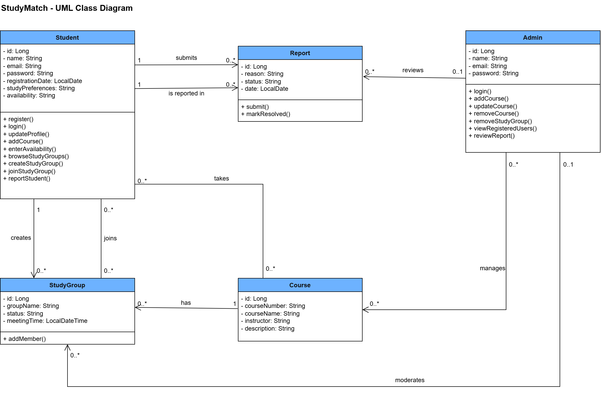

# StudyMatch backend API

# UML Class Diagram



## Deployment

**Render API URL:** https://studymatch-backend-stmq.onrender.com/  

The API is deployed on Render and uses Neon PostgreSQL for persistent database storage.

### Cold-Start Note

This API uses Render's free tier. The service may sleep after a period of inactivity. The first request after the service has been idle can take up to a minute while it starts.


## Study groups

| Method | Path | Purpose | Response code | Error codes | User story | Implemented by |
| ------ | ---- | ------- | ------------- | ----------- | ---------- | -------------- |
| `DELETE` | `/api/study-groups/{id}` | Remove a study group by ID | `204 No Content` | `404` | **US-6 — Remove Inappropriate Groups** | Angel Lopez |

## Courses

| Method | Path | Purpose | Response code | Error codes | User story | Implemented by |
| ------ | ---- | ------- | ------------- | ----------- | ---------- | -------------- |
| `GET` | `/api/courses` | Retrieve all courses | `200 OK` | — | **US-7 — Manage Course Listings** | Angel Lopez |
| `GET` | `/api/courses/{id}` | Retrieve a course by ID | `200 OK` | `404` | **US-7 — Manage Course Listings** | Angel Lopez |
| `POST` | `/api/courses` | Create a course | `201 Created` | `400` | **US-7 — Manage Course Listings** | Angel Lopez |
| `PUT` | `/api/courses/{id}` | Update a course | `200 OK` | `404` | **US-7 — Manage Course Listings** | Angel Lopez |
| `DELETE` | `/api/courses/{id}` | Delete a course by ID | `204 No Content` | `404` | **US-7 — Manage Course Listings** | Angel Lopez |

### Example Course Request

```http
POST /api/courses
Content-Type: application/json
```

```json
{
  "courseName": "CSC340"
}
```

### Example Course Update Request

```http
PUT /api/courses/2
Content-Type: application/json
```

```json
{
  "courseName": "CSC340 - Software Engineering"
}
```

## Registered users

| Method | Path | Purpose | Response code | Error codes | User story | Implemented by |
| ------ | ---- | ------- | ------------- | ----------- | ---------- | -------------- |
| `GET` | `/api/students` | Retrieve all registered students | `200 OK` | — | **US-8 — View Registered Users** | Angel Lopez |

## Reports

| Method | Path | Purpose | Response code | Error codes | User story | Implemented by |
| ------ | ---- | ------- | ------------- | ----------- | ---------- | -------------- |
| `GET` | `/api/reports` | Retrieve all reports, including the reported student and reporter | `200 OK` | — | **US-9 — Review Reported Users** | Angel Lopez |
| `GET` | `/api/reports/{id}` | Retrieve a report by ID | `200 OK` | `404` | **US-9 — Review Reported Users** | Angel Lopez |
| `POST` | `/api/reports` | Create a report identifying the reported student and reporter | `201 Created` | `400` | **US-9 — Review Reported Users** | Angel Lopez |
| `PUT` | `/api/reports/{id}` | Review a report by updating its details and status | `200 OK` | `404` | **US-9 — Review Reported Users** | Angel Lopez |

### Example Report Request

```http
POST /api/reports
Content-Type: application/json
```

```json
{
  "reason": "Inappropriate behavior in a study group",
  "status": "Pending",
  "date": "2026-10-19",
  "reportedStudent": {
    "id": 2
  },
  "reporter": {
    "id": 1
  }
}
```

### Example Report Review Request

```http
PUT /api/reports/1
Content-Type: application/json
```

```json
{
  "reason": "Inappropriate behavior in a study group",
  "status": "Reviewed",
  "date": "2026-10-19"
}
```

Passwords and database connection strings are intentionally excluded from this documentation.


## Student Profiles — US-1

| Method | Path | Purpose | Success | Errors | Implemented by |
|---|---|---|---|---|---|
| GET | `/api/students` | View all students | 200 | — | Ahnesti Lott |
| GET | `/api/students/{id}` | View a student profile | 200 | 404 | Ahnesti Lott |
| POST | `/api/students` | Register a student profile | 201 | 400 | Ahnesti Lott |
| PUT | `/api/students/{id}` | Edit a student profile | 200 | 400, 404 | Ahnesti Lott |

**User Story US-1:** As a student, I want to create a profile so that other students can learn about my study preferences.

### Example Student Creation

POST `/api/students`

```json
{
  "name": "Test Student",
  "email": "teststudent@example.com",
  "password": "TestPassword123!",
  "studyPreferences": "Group studying",
  "availability": "Monday evenings"
}
```

### Example Student Profile Update

PUT `/api/students/1`

```json
{
  "name": "Updated Test Student",
  "email": "teststudent@example.com",
  "studyPreferences": "Quiet individual studying",
  "availability": "Tuesday and Thursday afternoons"
}
```

## Course Enrollment — US-2

| Method | Path | Purpose | Success | Errors | Implemented by |
|---|---|---|---|---|---|
| POST | `/api/students/{studentId}/courses/{courseId}` | Enroll a student in a course | 200 | 404 | Ahnesti Lott |
| GET | `/api/courses/{id}/students` | View students enrolled in a course | 200 | 404 | Ahnesti Lott |

**User Story US-2:** As a student, I want to add my courses so that I can find students taking the same classes.

### Example Course Enrollment

POST `/api/students/1/courses/1`

No request body is required. Both student and course must already exist.

The relationship is stored in the `student_courses` PostgreSQL join table.

## Browse Relevant Study Groups — US-3

| Method | Path | Purpose | Success | Errors | Implemented by |
|---|---|---|---|---|---|
| GET | `/api/study-groups` | Browse all study groups | 200 | — | Ahnesti Lott |
| GET | `/api/study-groups/student/{studentId}` | Browse groups in a student's enrolled courses | 200 | 404 | Ahnesti Lott |
| GET | `/api/study-groups/{groupId}/members` | View members of a study group | 200 | 404 | Ahnesti Lott |

**User Story US-3:** As a student, I want to browse study groups in my courses so I can find relevant groups.

### Example

GET `/api/study-groups/student/1`

Returns study groups associated with courses that student 1 is enrolled in.

No request body is required.

## Create and Join Study Groups — US-4

| Method | Path | Purpose | Success | Errors | Implemented by |
|---|---|---|---|---|---|
| POST | `/api/study-groups` | Create a study group | 201 | See note below | Ahnesti Lott |
| POST | `/api/study-groups/{groupId}/members/{studentId}` | Join an existing study group | 200 | 404 | Ahnesti Lott |

**User Story US-4:** As a student, I want to create study groups so that I can organize sessions with classmates.

### Example Study Group Creation

POST `/api/study-groups`

```json
{
  "groupName": "CSC 340 Study Group",
  "status": "ACTIVE",
  "meetingTime": "2026-10-28T18:00:00",
  "course": {
    "id": 1
  },
  "creator": {
    "id": 1
  }
}
```

The course and creator IDs refer to existing records. The current implementation accepts nested ID objects; explicit validation of those references is still being finalized.

### Example Joining a Study Group

POST `/api/study-groups/1/members/1`

No request body is required.

Successful response:

```json
{
  "message": "Student joined study group successfully"
}
```

Memberships are stored in the `study_group_members` PostgreSQL join table.

## Student Availability — US-5

| Method | Path | Purpose | Success | Errors | Implemented by |
|---|---|---|---|---|---|
| PUT | `/api/students/{id}` | Update availability and study preferences | 200 | 400, 404 | Ahnesti Lott |

**User Story US-5:** As a student, I want to enter my availability so that I can find sessions that fit my schedule.

### Example Availability Update

PUT `/api/students/1`

```json
{
  "name": "Updated Test Student",
  "email": "teststudent@example.com",
  "studyPreferences": "Group studying",
  "availability": "Monday and Wednesday evenings"
}
```

The current implementation updates availability through the student profile endpoint.

## Development and Testing

Student API endpoints were tested locally using Postman with a separate Neon PostgreSQL development branch (`alott-dev`).

Verified operations include:
- Creating and updating student profiles
- Rejecting invalid student input with HTTP 400
- Returning HTTP 404 for a nonexistent student
- Enrolling students in courses
- Retrieving enrolled students for a course
- Creating and browsing study groups
- Joining groups and retrieving group members
- Filtering study groups by enrolled courses
- Confirming enrollment and membership records in Neon

These results reflect local development testing. The live Render API must be tested again after the team's changes are merged and deployed.

### Security and Configuration Notes

Database credentials are configured through environment variables rather than committed to GitHub.

Student password hashing and additional relationship validation require final review before production use. Test accounts should use fictional information and disposable passwords.

